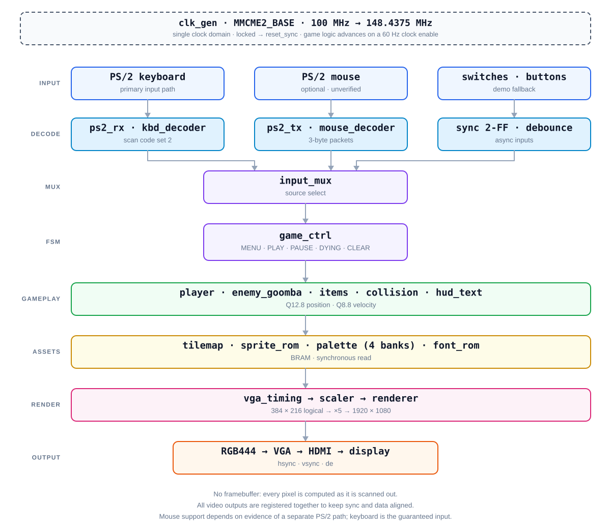

# MarioKan

**A from-scratch hardware game engine for FPGA.** A 2D platformer rendered and
simulated entirely in programmable logic — no CPU, no operating system, no
software running anywhere in the signal path.

[](#hardware-target)
[](#)
[](#)
[](#video-pipeline)

---

## Overview

MarioKan is a platformer engine — player physics, enemies, items, collision,
scoring, and a full game state machine — written as synthesizable VHDL and
targeting a Digilent Basys 3 board (Xilinx Artix-7 `XC7A35T-1CPG236C`). It is
built to run standalone on the board, with no host computer in the loop.

The design is defined by what it deliberately leaves out:

- **No framebuffer.** There is no external SDRAM or DDR on the board, and no
  on-chip memory large enough to hold a 1920×1080 frame. Every pixel is
  computed as it is scanned out, in a short pipelined datapath that reads tile
  and sprite ROMs on demand.
- **No soft CPU.** No NIOS, no MicroBlaze, no RISC-V core. Game logic is
  concurrent hardware, updated 60 times per second via a clock enable derived
  from the vertical blanking interval.
- **No derived clocks.** A single MMCM output feeds the entire design; slower
  rates are expressed as clock enables, which keeps timing analysis honest.
- **No floating point.** Position and velocity are fixed-point integers
  (Q12.8 for world position, Q8.8 for velocity), because `real` is not
  synthesisable and never will be.

The renderer is designed around a 384×216 logical resolution upscaled by an
exact integer factor of 5 to 1920×1080. That trades 25× of pixel work for a
small sub-pixel counter, and it is what makes 1080p60 feasible on a low-end,
slowest-speed-grade part.

## Hardware target

| | |
|---|---|
| Board | Digilent Basys 3 |
| FPGA | Xilinx Artix-7 `XC7A35T-1CPG236C` |
| Logic capacity | ~20,800 LUTs · 41,600 FFs · 50 BRAM36 · 90 DSP · 5 MMCM |
| Board clock | 100 MHz (`W5`) |
| Video out | VGA, 4 bits per channel (12-bit color) |
| Input | USB-HID via on-board PIC24, presented to the FPGA as **PS/2** |
| Audio | No codec on board — synthesis via Pmod (planned) |
| External memory | None usable |

## Video pipeline

CEA-861 timing for 1920×1080 @ 60 Hz:

| | Active | Front porch | Sync | Back porch | Total |
|---|---|---|---|---|---|
| Horizontal (px) | 1920 | 88 | 44 | 148 | **2200** |
| Vertical (lines) | 1080 | 4 | 5 | 36 | **1125** |

2200 × 1125 × 60 Hz = 148.5 MHz. The MMCM produces **148.4375 MHz** from the
100 MHz board clock (`CLKFBOUT_MULT_F=11.875`, `DIVCLK_DIVIDE=1`,
`CLKOUT0_DIVIDE_F=8`), a deviation of −0.042% — well inside the 0.5% tolerance
monitors actually accept.

```
clk 100 MHz ──► MMCME2_BASE ──► clk_pix 148.4375 MHz ──► vga_timing ──► scaler ──► renderer ──► RGB444
                                      │
                                      └──► clock enable @ 60 Hz ──► game logic
```

Pixel coordinates are mapped to a 384×216 logical grid (48×27 tiles of 8×8),
then scaled ×5. All video outputs — `hsync`, `vsync`, `de`, RGB — are
registered together so they stay aligned.

## Architecture



*Block diagram of the design. See [Project status](#project-status) for what is
actually implemented.*

| Module | Responsibility |
|---|---|
| `top_basys3` | Top level: wiring and pin assignment only |
| `clk_gen`, `reset_sync` | Pixel clock generation, reset release after lock |
| `vga_timing`, `scaler`, `renderer` | Sync generation, coordinate scaling, pixel composition |
| `tile_rom`, `level_rom`, `sprite_rom`, `palette` | Asset storage |
| `ps2_rx`, `ps2_tx`, `kbd_decoder`, `mouse_decoder` | PS/2 transport and decoding |
| `input_mux` | Input source selection, including fallback path |
| `game_pkg` | Constants, types, fixed-point formats, state enum |
| `game_ctrl` | Main game state machine |
| `player`, `enemy_goomba`, `items`, `collision` | Physics, enemy control, items, AABB/tile collision |
| `hud_text`, `seg7_mux` | On-screen HUD and 7-segment debug output |

The diagram is generated from source, not hand-drawn:

```powershell
python tools/make_architecture.py   # writes docs/diagram/arsitektur.svg
```

## Project status

This project is built in stages, and each stage has a defined exit criterion.
The table below reports **what has actually been proven**, not what is planned.

Evidence levels used throughout this repository:

| Level | Meaning |
|---|---|
| `SIM` | Verified in simulation only |
| `SYN` | Verified through synthesis, place & route, and timing closure |
| `BOARD` | Verified running on physical hardware |

| Milestone | Status | Evidence |
|---|---|---|
| Toolchain and target device available | `SYN` | Vivado 2026.1; `xc7a35tcpg236-1` present among 30 installed `xc7a35t*` parts |
| 148.4375 MHz pixel clock achievable on `-1` speed grade | `SYN` | `clk_pix` period 6.737 ns; **WNS +4.041 ns**, WHS +0.238 ns; 0 DRC errors |
| Bitstream generation | `SYN` | 2.19 MB `.bit` produced |
| Game RTL (video, input, gameplay, audio) | — | **not implemented yet** |
| On-board verification | — | **not performed yet** |

> The bitstream referenced above is a *probe* design (MMCM + counter), not the
> game. It establishes that the toolchain path works and that the pixel clock
> is achievable on this speed grade. It is **not** evidence that the game runs.

## Repository layout

```
src/                VHDL RTL                        (in progress)
constraints/        Basys 3 XDC                      (in progress)
sim/                VHDL testbenches                 (in progress)
tools/
  build.tcl         Vivado batch build script
  make_architecture.py   Generates the architecture diagram (SVG)
  make_diagram.py        Generates the proposal block diagram (PNG)
  make_proposal.py       Generates the proposal document (DOCX)
docs/
  PRD.md            Specification — authoritative requirements
  checkpoint.md     Work log and current status
  diagram/          Generated diagrams
```

Local-only material (not tracked, excluded via `.gitignore`): `docs/brief/`,
`docs/rubrik.md`, `docs/proposal/`.

`build.tcl` expects `src/` to exist and to contain at least one `.vhd` file;
it exits with an explicit message otherwise. As of now `src/` is still empty.

## Building

Requires Vivado 2026.1 with the Artix-7 device family installed.

```powershell
# full flow: synth → opt → place → route → bitstream
vivado -mode batch -source tools/build.tcl

# synthesis only, faster turnaround while iterating
vivado -mode batch -source tools/build.tcl -tclargs --synth-only
```

Outputs land in `build/`:

```
build/reports/timing_summary.rpt
build/reports/utilization.rpt
build/reports/clock_utilization.rpt
build/reports/drc.rpt
build/reports/power.rpt
build/top_basys3.bit
```

The build writes those reports; the project's acceptance gates are then checked
against them: **WNS ≥ 0**, **WHS ≥ 0**, **zero inferred latches**, **zero DRC
errors**, and utilization below the device limits listed above. Build
artifacts (`build/`, `*.bit`, `*.dcp`, `.Xil/`) are git-ignored.

> **Path caveat.** Vivado's Tcl parser splits arguments on whitespace. If the
> checkout path contains spaces, an unwrapped path produces
> `ERROR: File 'C:/some/path' is a directory`. Wrap every path argument in
> `[list ...]`:
>
> ```tcl
> read_vhdl -vhdl2008 [list $f]
> ```
>
> `tools/build.tcl` already does this throughout. Verified behaviour; see
> `docs/checkpoint.md`. The long-term fix is a checkout path without spaces.

## Contributing

See [`CONTRIBUTING.md`](CONTRIBUTING.md) for roles, branch workflow, and the
evidence rules that apply to every claim made in this repository.

## Design notes

Behavioural reference for game physics, enemy logic, and sprite sequencing is
[nicklesimba/FPGA-Mario](https://github.com/nicklesimba/FPGA-Mario)
(Nikhil Simha, Pranith Bottu) — an academic DE2/Quartus project using a NIOS II
soft core. MarioKan is not a port: the original design's soft CPU, Qsys
subsystem, USB host interface, and audio codec have no counterpart here. What
is carried over is *behaviour* — jump curves, collision response, animation
order — reimplemented as standalone hardware.

## Licensing and attribution

Source code in this repository is provided for educational and non-commercial
use.

Character designs and sprite artwork are the property of Nintendo and are used
here solely for non-commercial, academic purposes. No affiliation with or
endorsement by Nintendo is claimed or implied.
