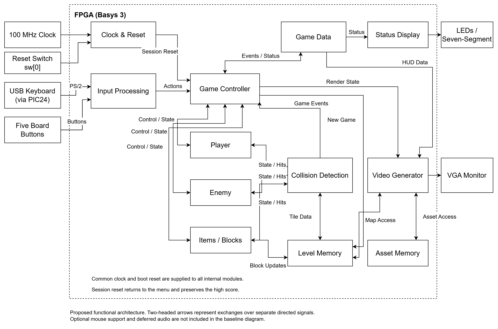

# MarioKan

MarioKan is a planned 2D platformer in VHDL for the Digilent Basys 3.
The intended game implements physics, collision and video in FPGA logic,
without a soft CPU or operating system.

> **Current stage: architecture and standalone probes.** Production game RTL
> is not implemented yet. There is no playable game or functional BOARD
> verification to download; the evidence below is limited to separate probes.

[Architecture](#architecture) · [Verified progress](#project-status) ·
[Planned controls](#planned-game-and-controls) · [Documentation](#documentation) ·
[Build and checks](#building)



Functional architecture approved on 2026-11-12, exported by draw.io.
[Editable draw.io source](docs/diagram/arsitektur.drawio) ·
[Export provenance and hashes](docs/diagram/arsitektur-export.json).
This is a design diagram, not a synthesized netlist or game screenshot.

## Overview

The design covers player physics, enemies, items, collision, scoring and a
game state machine in synthesizable VHDL, targeting a Digilent Basys 3 board
(Xilinx Artix-7 `XC7A35T-1CPG236C`). The intended game runs standalone on the
board, with no host computer in the loop; this is not a claim of a working game.

The minimum delivery is one complete level. Up to four additional maps are
optional development after that baseline is verified, reusing the same
mechanics and assets rather than introducing a separate game engine per level.

The design is defined by what it deliberately leaves out:

- **No framebuffer.** There is no external SDRAM or DDR on the board, and no
  on-chip memory large enough to hold a 1920×1080 frame. Every pixel is
  computed as it is scanned out, in a short pipelined datapath that reads tile
  and sprite ROMs on demand.
- **No soft CPU.** No NIOS, no MicroBlaze, no RISC-V core. Game logic is
  concurrent hardware, updated 60 times per second via a clock enable derived
  from the vertical blanking interval.
- **No derived clocks.** A single MMCM output feeds the entire design; slower
  rates are expressed as clock enables, which keeps timing analysis honest.
- **No floating point.** Position and velocity are fixed-point integers
  (Q13.8 for world position, Q8.8 for velocity), rather than synthesized
  floating-point arithmetic. Q13.8 is 21-bit signed; 12 integer bits
  give ±4095.996 px, enough for a 3392 px level; a 20-bit Q12.8 would saturate
  at ±2047.996.

The renderer is planned around a 384×216 logical resolution upscaled by an
exact integer factor of 5 to 1920×1080. Reusing logical pixels may reduce
work, but does not automatically provide 25 consecutive clocks per fetch.
ROM/port scheduling and integrated timing still need verification.

## Planned game and controls

The game starts at a menu. START initializes one complete level; the player
walks, runs and jumps past Goombas, collects coins and power-ups, and reaches
the flagpole to clear the level. Pause, death/respawn and game-over states
are part of the design. Up to four additional maps are optional, not part
of the minimum delivery. Audio is deferred and mouse support is optional.

Both control paths must eventually support the complete game independently.
These are approved mappings, **not controls demonstrated on a working game**.

| Action | Basys 3 buttons | External USB keyboard via PIC24/PS/2 |
|---|---|---|
| Menu up/down | Up/down | Up/down arrows |
| Confirm / START | Center | Enter |
| Move | Hold left/right | Hold left/right arrows or A/D |
| Variable-height jump | Up | Space, up arrow or W |
| Run / fire when FIRE | Down | Left Shift or Z |
| Pause / resume | Center | P or Esc |

Jump and fire require a new press; holding jump does not trigger another
jump on landing, and holding fire does not auto-repeat. Holding the action
button with a direction runs. `sw[0]=1` holds session reset; returning it to
`0` opens the menu. The next START restores three lives, zero score/coins,
initial time and map state. High score survives session reset, not power-off
or reprogramming. Respawn instead retains score, coins and changed tiles.
See the [input guide](docs/INPUT_GUIDE.md) for physical connections and examples.

## Hardware target

| | |
|---|---|
| Board | Digilent Basys 3 |
| FPGA | Xilinx Artix-7 `XC7A35T-1CPG236C` |
| Logic capacity | ~20,800 LUTs · 41,600 FFs · 50 BRAM36 · 90 DSP · 5 MMCM |
| Board clock | 100 MHz (`W5`) |
| Video out | VGA, 4 bits per channel (12-bit color) |
| Display path | Direct VGA to a monitor; the test monitor must be borrowed and its 1080p input support is not verified yet |
| Input | Two planned full control paths: USB keyboard via PIC24/**PS/2**, or the five on-board buttons |
| Audio | No codec on board; deferred from the baseline, optional future Pmod work |
| External memory | None usable |

For the five on-board buttons and external USB keyboard connection, see the
[input guide](docs/INPUT_GUIDE.md). Neither gameplay control path nor session
reset is implemented yet. The separate raw-input diagnostic is not their
implementation; the laptop programmer cable does not forward laptop keystrokes.

## Video pipeline

CEA-861 timing for 1920×1080 @ 60 Hz:

| | Active | Front porch | Sync | Back porch | Total |
|---|---|---|---|---|---|
| Horizontal (px) | 1920 | 88 | 44 | 148 | **2200** |
| Vertical (lines) | 1080 | 4 | 5 | 36 | **1125** |

2200 × 1125 × 60 Hz = 148.5 MHz. The MMCM produces **148.4375 MHz** from the
100 MHz board clock (`CLKFBOUT_MULT_F=11.875`, `DIVCLK_DIVIDE=1`,
`CLKOUT0_DIVIDE_F=8`), a deviation of about −0.042%. This does not guarantee
that a particular monitor accepts the mode; the actual VGA display must be tested.

```
clk 100 MHz ──► MMCME2_BASE ──► clk_pix 148.4375 MHz ──► vga_timing ──► scaler ──► renderer ──► RGB444
                                      │
                                      └──► clock enable @ 60 Hz ──► game logic
```

Pixel coordinates are mapped to a 384×216 logical grid (48×27 tiles of 8×8),
then scaled ×5. The planned pipeline registers `hsync`, `vsync`, `de` and RGB
with the same latency to keep them aligned. Integrated video is not tested yet.

## Architecture

The approved system-level diagram is
[`docs/diagram/arsitektur.drawio`](docs/diagram/arsitektur.drawio).
It was reviewed in draw.io by the owner and approved on 2026-11-12.
The editable master uses monochrome native shapes and connectors.

This is a functional architecture, not a synthesized RTL netlist. A block
can contain several VHDL entities; detailed implementation interfaces remain
part of the technical design. See [Project status](#project-status) for what
has actually been implemented.

| Functional block | Responsibility |
|---|---|
| Clock & Reset | Pixel clock, boot initialization and session-reset input |
| Input Processing | Keyboard reception/decoding, button debounce and normalized actions |
| Game Controller | Menu/game FSM, update coordination and render-state collection |
| Player | Player motion, form and animation state |
| Enemy | Goomba management and behavior |
| Items / Blocks | Items, fireballs and mutable block behavior |
| Collision Detection | Tile/object checks, hit results and game events |
| Game Data | Score, coins, lives, time and high score |
| Level Memory | Initial map and mutable active map |
| Asset Memory | Synchronous tile, sprite, font and palette storage |
| Video Generator | Timing, scaling, composition and aligned VGA output |
| Status Display | LED encoding and seven-segment scanning |

Rendered report/README exports must come from the approved draw.io master.
The preview above is the same official export used in the local report.
Its manifest records the unchanged master and image hashes. The academic
document itself is not published. Shared clock/boot reset, frame/commit
enables and return handshakes (map-ready/spawn, block-write-ready and
game-event-ready) are detailed interfaces, not separately drawn connections.
The old
`docs/diagram/arsitektur.svg` and its generator are retained as legacy,
not as the current architecture source. Rejected v2 candidates and their
generator/tests are local-only and ignored; no file was deleted. Do not
overwrite the approved design with those candidates.

Asset readiness and the limits of the preliminary memory estimate are recorded
in [Asset feasibility](docs/ASSET_FEASIBILITY.md). Source PNGs are available,
but target sprite ROMs and the conversion tool are not implemented yet.
The platform/interface comparison with the pinned reference HDL is in
[Adaptation notes](docs/PORTING_NOTES.md), not a claim of a completed port.

## Project status

This project is built in stages, and each stage has a defined exit criterion.
The table below reports **what has actually been proven**, not what is planned.

Evidence levels used throughout this repository:

| Level | Meaning |
|---|---|
| `SIM` | Verified in simulation only |
| `SYN` | Verified through synthesis, place & route, and timing closure |
| `BOARD` | Verified running on physical hardware |

| Milestone | Status | Evidence |
|---|---|---|
| Toolchain and target device available | `SYN` | Vivado 2026.1; `xc7a35tcpg236-1` present among 30 installed `xc7a35t*` parts |
| 148.4375 MHz pixel clock achievable on `-1` speed grade | `SYN` (archived probe) | `clk_pix` period 6.737 ns; final report **WNS +4.043 ns**, WHS +0.254 ns; 0 DRC findings |
| Bitstream generation | `SYN` | 2.19 MB `.bit` produced |
| Standalone input diagnostic (not game controls) | `SIM` / `SYN` | `tb_input_probe` passes; diagnostic at 148.4375 MHz: WNS +2.068 ns, WHS +0.128 ns, 99 LUT / 216 FF, 0 latch/DRC/critical warning; not programmed or physically tested yet |
| Game RTL (video, input, gameplay) | No result | **not implemented yet** |
| Functional board verification | No `BOARD` result | **not performed yet** |

> There are two separate probes: the archived MMCM/counter and the newer raw
> input diagnostic. Neither is the game. Their SIM/SYN evidence does not
> establish physical input behavior, gameplay or a compatible VGA monitor.

These are results from local probe reports. The probe sources, bitstreams
and raw logs are not distributed in this public snapshot, so cloning the
repository alone does not reproduce those hardware results. Next steps are
physical input observation with the owner, a verified 1080p VGA monitor,
and locking the open implementation parameters before production RTL.

## Documentation

The README stays in English. Detailed working notes retain their existing
Indonesian or English text; their links below are part of the public repo.

| Read next | What it covers |
|---|---|
| [Requirements and decisions](docs/PRD.md) | Scope, planned behavior, module hierarchy and open questions |
| [Input guide](docs/INPUT_GUIDE.md) | Physical connections, approved board/keyboard mappings and reset semantics |
| [Asset feasibility](docs/ASSET_FEASIBILITY.md) | Source PNG audit, palette/ROM plan and limits of memory estimates |
| [Adaptation notes](docs/PORTING_NOTES.md) | Pinned-reference interface differences and what must be rewritten |
| [Current progress and checkpoints](CHECKPOINTS.md) | Latest state, evidence limits and historical work log |
| [Contributing](CONTRIBUTING.md) | Review workflow and the docs/simulation-only contributor boundary |

The diagram and planned controls explain the system for coursework readers.
The evidence table separates engineering results from goals for portfolio
readers; contributors should read the requirements and contribution rules
before changing files.

## Repository layout

```
CHECKPOINTS.md      Work log and current status
src/                Production VHDL RTL              (planned, empty)
constraints/        Production Basys 3 XDC           (planned)
sim/                Production VHDL testbenches      (planned)
tools/
  build.tcl         Vivado batch build script
  make_architecture.py   Legacy SVG generator (not the approved diagram source)
  make_diagram.py        Legacy proposal PNG generator (not the draw.io master)
  check_project_notes.py Active-note and public-checkpoint consistency guard
  check_patch.py      Preflight for one-file update patches (no changes applied)
docs/
  PRD.md            Specification: authoritative requirements
  checkpoint.md     Legacy pointer to ../CHECKPOINTS.md
  INPUT_GUIDE.md    Approved physical controls and evidence limits
  ASSET_FEASIBILITY.md Source asset audit, not final ROM utilization
  PORTING_NOTES.md  Pinned-reference platform/interface comparison
  diagram/          Approved editable draw.io master and legacy diagram material
```

Local-only material (not tracked, excluded via `.gitignore`): `docs/brief/`,
`docs/rubrik.md`, `docs/proposal/`, `tools/make_proposal.py`, `.tmp/`,
`reference/`, and the rejected v2 diagram candidates listed in `.gitignore`.
The public checkpoint preserves source documentation and the approved master,
not local academic documents, diagnostic binaries or scratch evidence.

`build.tcl` expects `src/` to exist and to contain at least one `.vhd` file;
it exits with an explicit message otherwise. As of now `src/` is still empty.

## Building

The production RTL and XDC are not present yet, so the game build is not
currently runnable. The script stops with an explicit missing-source message;
the commands under [Checking notes and tooling](#checking-notes-and-tooling)
can be run now without Vivado.

Once production sources exist, the game build requires Vivado 2026.1 with
the Artix-7 device family installed. Run from the repo root, placing Vivado's
working files under `.tmp/build/`:

```powershell
$repo = (Get-Location).Path
New-Item -ItemType Directory -Force "$repo/.tmp/build" | Out-Null
Push-Location "$repo/.tmp/build"
try {
    & 'D:/AMDDesignTools/2026.1/Vivado/bin/vivado.bat' -mode batch -source "$repo/tools/build.tcl"
    # For synthesis only, append: -tclargs --synth-only
} finally {
    Pop-Location
}
```

Outputs land in `build/`:

```
build/reports/timing_summary.rpt
build/reports/utilization.rpt
build/reports/clock_utilization.rpt
build/reports/drc.rpt
build/reports/power.rpt
build/top_basys3.bit
```

The build writes those reports; the project's acceptance gates are then checked
against them: **WNS ≥ 0**, **WHS ≥ 0**, **zero inferred latches**, **zero DRC
errors**, and utilization below the device limits listed above. Build
artifacts (`build/`, `*.bit`, `*.dcp`, `.Xil/`) are git-ignored.

> **Path caveat.** Vivado's Tcl parser splits arguments on whitespace. If the
> checkout path contains spaces, an unwrapped path produces
> `ERROR: File 'C:/some/path' is a directory`. Wrap every path argument in
> `[list ...]`:
>
> ```tcl
> read_vhdl -vhdl2008 [list $f]
> ```
>
> `tools/build.tcl` already does this throughout. The parent folder rename
> completed on 2026-10-22; the current checkout has no spaces in its path.
> Keep quoting paths for checkouts elsewhere. See `CHECKPOINTS.md` for history.

## Checking notes and tooling

```powershell
python -B tools/check_project_notes.py
New-Item -ItemType Directory -Force .tmp | Out-Null
python -B -m unittest discover -s tools/tests -v
```

The first command checks selected active-note invariants and local-only
boundaries, including the Git index. The public suite checks patch preflight,
the retained legacy SVG generator, README links and the approved PNG's
dimensions and hashes against its draw.io source manifest. It does not
re-export or visually validate draw.io, and it does not simulate the VHDL game.
Academic DOCX tests and raw-input diagnostic evidence are local-only; they
are not expected to exist after cloning just the public repository.

## Contributing

See [`CONTRIBUTING.md`](CONTRIBUTING.md) for roles, branch workflow, and the
evidence rules that apply to every claim made in this repository.

## Design notes

Behavioural reference for game physics, enemy logic, and sprite sequencing is
[nicklesimba/FPGA-Mario](https://github.com/nicklesimba/FPGA-Mario)
(Nikhil Simha, Pranith Bottu), an academic DE2/Quartus project using a NIOS II
soft core. MarioKan is not a direct port: the original soft CPU, Qsys, USB
host interface and audio codec are not part of this target. Selected behavior
is a reference for a new VHDL implementation, not code already adapted and
verified on Basys 3. Attribution and Nintendo's character/artwork rights
remain applicable.

## Licensing and attribution

Source code in this repository is provided for educational and non-commercial
use.

Character designs and sprite artwork are the property of Nintendo and are used
here solely for non-commercial, academic purposes. No affiliation with or
endorsement by Nintendo is claimed or implied.
